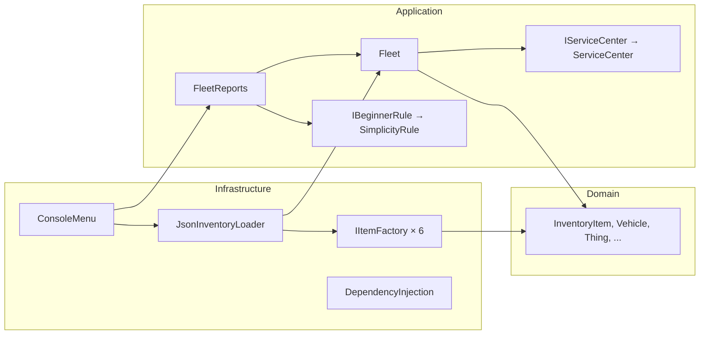
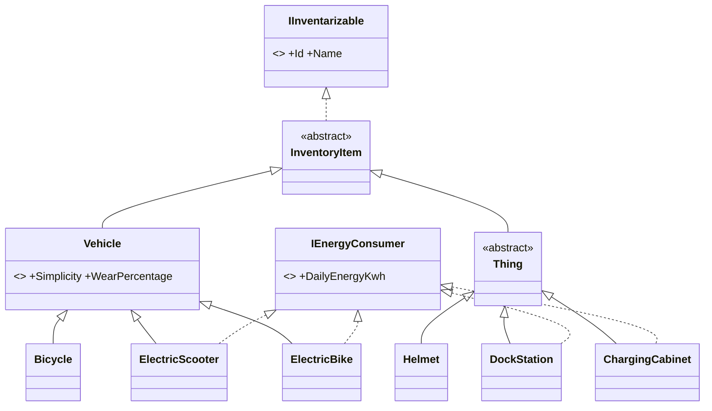

# 🛴 ВышКат — учёт парка кикшеринга

> **«Доедем до дедлайна»**
> Домашнее задание №1 по курсу «Конструирование программного обеспечения», НИУ ВШЭ.
> Тема: SOLID · DI-контейнер · юнит-тесты.


Консольное приложение учёта парка «ВышКат». Техника и вещи принимаются из JSON-файла
и попадают на баланс только после техосмотра. Приложение показывает число единиц,
суммарное суточное энергопотребление, технику для новичков и инвентарную ведомость.

---

## 📑 Содержание

- [Быстрый старт](#-быстрый-старт)
- [Что умеет приложение](#-что-умеет-приложение)
- [Формат входного файла](#-формат-входного-файла)
- [Архитектура](#-архитектура)
- [Доменная модель](#-доменная-модель)
- [SOLID в проекте](#-solid-в-проекте)
- [Ответы на обязательные вопросы](#-ответы-на-обязательные-вопросы)
- [Тесты](#-тесты)
- [Роль ИИ](#-роль-ии)

---

## 🚀 Быстрый старт

Нужен [.NET SDK 8](https://dotnet.microsoft.com/download/dotnet/8.0). Все команды запускаются из корня репозитория.

**Интерактивный режим:**

```bash
dotnet run --project MyVyshKat
```

**Демонстрация всех сценариев одной командой.** Нажатия клавиш берутся из файла, вводить ничего не нужно:

```bash
dotnet run --project MyVyshKat < data/demo-input.txt
```

**Тесты:**

```bash
dotnet test
```

---

## ✨ Что умеет приложение

```
VyshKat fleet accounting
1. Accept items from a JSON file
2. Fleet summary: units and total daily energy
3. Vehicles for beginners
4. Inventory list
0. Exit
```

| Пункт | Что делает | Требование ТЗ |
|---|---|---|
| **1** | Читает JSON-файл. Каждый предмет проходит проверку номера и техосмотр, по каждому выводится «принят» или «отклонён» с причиной | приём техники, техосмотр |
| **2** | Число единиц на балансе и суммарный суточный расход энергии | отчёт по числу единиц и энергии |
| **3** | Транспорт, который можно выдавать новичкам, и правило отбора | список для новичков |
| **4** | Инвентарный номер и наименование всей техники и вещей | вывод инвентарных номеров |
| **0** | Выход. Программа также штатно завершается, когда кончается ввод | — |

Демо-данные лежат в [`data/fleet.json`](data/fleet.json), а не в коде. Ошибки ввода программу не роняют:

- неверный пункт меню → подсказка;
- несуществующий файл или битый JSON → сообщение «Cannot load file»;
- некорректный предмет → пропускается с причиной, остальные загружаются.

<details>
<summary><b>Пример вывода загрузки <code>data/fleet.json</code></b></summary>

```
  [accepted] ElectricScooter VK-001 (Ninebot Max G30)
  [accepted] ElectricBike VK-002 (Shengmilo MX02)
  [accepted] Bicycle VK-003 (Stels Navigator 300)
  [rejected] ElectricScooter VK-004 (Used scooter from Avito): Wear 85% exceeds the allowed 70%
  [rejected] ElectricScooter VK-005 (Kugoo with swollen battery): Daily energy consumption 2,4 kWh exceeds the limit of 1,5 kWh
  [rejected] Bicycle VK-001 (Duplicate number): Inventory number VK-001 is already taken
  [rejected] Item #7: Unknown type 'Monowheel'
  [rejected] Item #8: Simplicity must be between 1 and 10 (Parameter 'simplicity')
Actual value was 15.
  [accepted] Helmet VK-100 (VyshKat helmet, size M)
  [accepted] DockStation VK-101 (Dock at Pokrovka building)
  [accepted] ChargingCabinet VK-102 (Cabinet for 12 batteries)
Accepted 6 of 11

Units on balance: 6
Total daily energy consumption: 7.4 kWh

Vehicles for beginners (Simplicity >= 6):
  VK-001  Ninebot Max G30  simplicity 7/10
  VK-003  Stels Navigator 300  simplicity 9/10
```

</details>

---

## 📄 Формат входного файла

JSON-массив. Поле `type` определяет вид предмета, остальные поля зависят от вида:

```json
[
  { "type": "ElectricScooter", "id": "VK-001", "name": "Ninebot Max G30", "simplicity": 7, "wearPercentage": 10, "dailyEnergyKwh": 0.8 },
  { "type": "Bicycle",         "id": "VK-003", "name": "Stels Navigator 300", "simplicity": 9, "wearPercentage": 15 },
  { "type": "Helmet",          "id": "VK-100", "name": "VyshKat helmet, size M" },
  { "type": "DockStation",     "id": "VK-101", "name": "Dock at Pokrovka building", "dailyEnergyKwh": 3.5 }
]
```

| `type` | Поля |
|---|---|
| `ElectricScooter`, `ElectricBike` | `id`, `name`, `simplicity` (1–10), `wearPercentage` (0–100), `dailyEnergyKwh` (> 0) |
| `Bicycle` | `id`, `name`, `simplicity`, `wearPercentage` |
| `Helmet` | `id`, `name` |
| `DockStation`, `ChargingCabinet` | `id`, `name`, `dailyEnergyKwh` |

---

## 🏛 Архитектура

Три слоя. Зависимости направлены только внутрь: `Infrastructure → Application → Domain`.



```
MyVyshKat/
├── Domain/                     — что существует: техника, вещи, номера, энергия
│   ├── IInventarizable.cs      — инвентарный номер + наименование
│   ├── IEnergyConsumer.cs      — суточный расход, кВт·ч
│   ├── InventoryItem.cs        — общая база с проверкой номера и имени
│   ├── EnergyValidation.cs     — общая проверка расхода
│   ├── Vehicles/               — Vehicle → Bicycle, ElectricScooter, ElectricBike
│   └── Things/                 — Thing → Helmet, DockStation, ChargingCabinet
├── Application/                — что с этим делают
│   ├── IServiceCenter.cs, ServiceCenter.cs, InspectionResult.cs   — техосмотр
│   ├── IBeginnerRule.cs, SimplicityRule.cs                       — правило для новичков
│   ├── Fleet.cs                — парк: единственный вход на баланс
│   └── FleetReports.cs         — отчёты, только чтение парка
├── Infrastructure/             — связь с внешним миром
│   ├── ConsoleUi/ConsoleMenu.cs
│   ├── Files/JsonInventoryLoader.cs, LoadResult.cs
│   ├── Files/Factories/        — IItemFactory, ItemFactory и 6 фабрик
│   └── DependencyInjection.cs  — composition root
└── Program.cs
```

**Почему консоль и загрузка из файла лежат в одном слое.** Оба — внешние адаптеры: один общается с человеком, другой с файловой системой. Бизнес-логика в `Application` не знает ни про консоль, ни про JSON. Поэтому её можно тестировать без них и подключить другой ввод (например, веб) без правки логики.

---

## 🧩 Доменная модель



Ключевые решения:

- **«Кто ты» и «что умеешь» разделены.** Наследование задаёт *кто* (транспорт или вещь), интерфейсы — *что умеет* (потреблять энергию). Энергию потребляют и транспорт, и вещи, а базовый класс в C# может быть только один, поэтому `IEnergyConsumer` — интерфейс.
- **Расход есть только у тех, у кого он реально есть.** У велосипеда и шлема нет фиктивного «расхода 0», они просто не реализуют `IEnergyConsumer`.
- **Простота и износ есть только у транспорта**, потому что клиентам выдаётся только он.
- **Объект нельзя создать некорректным.** Все проверки стоят в конструкторах, свойства только для чтения. Простота 15, пустое имя или отрицательный расход дают исключение при создании, из какого бы места объект ни создавали.
- **Сотрудники не наследуются от `InventoryItem`**, поэтому никогда не попадут на баланс (по ТЗ их не инвентаризируют).

### Техосмотр

`ServiceCenter` проверяет **всё**, что ставится на баланс. В ТЗ сказано «решает, принимать ли новое *устройство* в парк», а перегруженная док-станция — тоже неисправное устройство. Проверки строятся по признакам, а не по конкретным классам:

| Объект | Износ ≤ 70% | Расход ≤ лимита |
|---|:---:|:---:|
| Электросамокат, электровелосипед | ✓ | ✓ (≤ 1.5 кВт·ч) |
| Велосипед | ✓ | — |
| Док-станция, зарядный шкаф | — | ✓ (≤ 5.0 кВт·ч) |
| Шлем | — | — |

У транспорта и вещей **разные лимиты расхода**: 3.5 кВт·ч — признак неисправной батареи у самоката, но норма для док-станции. Лимиты и порог «для новичков» (≥ 6) задаются в одном месте — `DependencyInjection.cs`.

---

## 🧱 SOLID в проекте

| Принцип | Где | Зачем |
|---|---|---|
| **S** — единственная ответственность | `Fleet` принимает и хранит, `FleetReports` считает, `ConsoleMenu` выводит, `JsonInventoryLoader` читает файл, каждая фабрика создаёт один вид | Изменение формата вывода не трогает расчёты, изменение регламента техосмотра не трогает меню |
| **O** — открытость/закрытость | Фабрики регистрируются в DI и попадают в загрузчик списком `IEnumerable<IItemFactory>`. Правила вынесены в `IServiceCenter` и `IBeginnerRule` | Новый вид или новое правило добавляются новым классом и строкой регистрации, загрузчик и отчёты не меняются |
| **L** — подстановка Лисков | Любой `InventoryItem` подходит в `Fleet.AddItem`, любой `IEnergyConsumer` — в расчёт энергии, любой `Vehicle` — в `IBeginnerRule` | Наследники не ослабляют контракты: все проверяют данные в конструкторе, никто не бросает «не поддерживается» |
| **I** — разделение интерфейсов | `IInventarizable` и `IEnergyConsumer` — маленькие и раздельные. `IServiceCenter`, `IBeginnerRule`, `IItemFactory` — по одному-два члена | Шлем не обязан иметь расход; отчёт по энергии зависит только от `IEnergyConsumer` |
| **D** — инверсия зависимостей | `Fleet` зависит от `IServiceCenter`, `FleetReports` — от `IBeginnerRule`, меню — от `TextReader`/`TextWriter`. Всё собирается в `DependencyInjection` | Техосмотр подменяется в тестах; меню тестируется на строках вместо консоли |

**Чего сознательно нет**, чтобы не было «декоративного» SOLID:

- **`IFleet`** — у парка одна реализация, и подменять его не нужно: тесты проверяют сам `Fleet` с фальшивым техосмотром;
- **репозитория** для хранения — данные живут в памяти, интерфейс ничего бы не дал;
- **конфиг-файла для лимитов** — три числа в одном месте регистрации найти и поменять проще, чем тянуть ради них ещё два пакета;
- **слоя на каждую папку** — консоль и файлы лежат в одном внешнем слое `Infrastructure`.

---

## ❓ Ответы на обязательные вопросы

### 1. Какой принцип SOLID применён наиболее явно и где?

**DIP.** [`Fleet`](MyVyshKat/Application/Fleet.cs) получает `IServiceCenter` через конструктор и не знает, по каким правилам идёт техосмотр. Какую реализацию использовать, решается в одном месте — [`DependencyInjection.AddMyVyshKat`](MyVyshKat/Infrastructure/DependencyInjection.cs). Благодаря этому тест подменяет техосмотр заглушкой, не трогая код парка.

Рядом **OCP**: [`JsonInventoryLoader`](MyVyshKat/Infrastructure/Files/JsonInventoryLoader.cs) получает все фабрики списком из контейнера и выбирает нужную по полю `type` через словарь. В нём нет `switch` по видам, и о конкретных классах он ничего не знает.

### 2. Какой принцип сознательно ограничен и почему это приемлемо?

- **OCP в [`ServiceCenter`](MyVyshKat/Application/ServiceCenter.cs).** Правила проверяются через `is Vehicle` и `is IEnergyConsumer`, а не цепочкой отдельных классов `IInspectionRule`. Правил два, и они стабильны. Точка расширения уже есть уровнем выше — сам `IServiceCenter`. Проверки идут по *признакам*, а не по конкретным классам, поэтому новый вид транспорта проверяется автоматически.
- **SRP в `InspectionResult`.** Этот же тип возвращает и `Fleet` при занятом номере, хотя это отказ парка, а не техосмотра. Отдельный тип `AcceptanceResult` с теми же двумя полями был бы дублированием.
- **OCP в [`ConsoleMenu`](MyVyshKat/Infrastructure/ConsoleUi/ConsoleMenu.cs).** Пункты меню выбираются обычным `switch`, а не паттерном «Команда». Пунктов пять, плагинами меню не расширяется.
- **LSP-приведение в меню.** `GetBeginnersItems` возвращает `InventoryItem`, и меню приводит его к `Vehicle`. Это безопасно, потому что правило применяется только к транспорту, но тип мог бы быть точнее.

### 3. Что сломается (или не сломается) при расширении?

| Расширение | Что нужно сделать | Что не меняется |
|---|---|---|
| **Новый вид транспорта**, например моноколесо | класс `Monowheel : Vehicle, IEnergyConsumer`, фабрика `MonowheelFactory`, одна строка в `DependencyInjection` | загрузчик, меню, отчёты, правило для новичков. Техосмотр сразу проверит у него и износ, и расход: он `Vehicle` и `IEnergyConsumer` |
| **Сотрудники службы эксплуатации** | своя сущность `Employee`, **не** наследник `InventoryItem`, свой реестр и пункт меню | парк, отчёты, ведомость. Сотрудник гарантированно не попадёт в число единиц и инвентарную ведомость, компилятор не даст передать его в `Fleet.AddItem` |
| **Склад запчастей** | `SparePart : Thing` + фабрика. Если нужно хранить *количество* под одним номером — новое понятие «складская позиция» и решение, как его считать в сводке | техосмотр, загрузчик, правило для новичков |
| **Новое правило для новичков**, например «простота ≥ 6 и износ ≤ 40%» | новая реализация `IBeginnerRule`, замена одной регистрации | `FleetReports`, меню |

### 4. Какой тест фиксирует решение техосмотра и правило «для новичков»? Как подменяется зависимость?

- **Регламент техосмотра:** [`ServiceCenterTests`](MyVyshKat.Tests/Application/ServiceCenterTests.cs). Износ 70% принимается, 71% — нет. Расход 3.5 кВт·ч — отказ самокату, но норма для док-станции. Шлем принимается.
- **Реакция парка на решение техосмотра:** [`FleetTests`](MyVyshKat.Tests/Application/FleetTests.cs). Техосмотр подменён [`FakeServiceCenter`](MyVyshKat.Tests/Fakes/FakeServiceCenter.cs) через конструктор `Fleet`. Это stub (возвращает заданное решение) и spy (запоминает, что ему показали). Проверяется, что принятое добавляется, отклонённое — нет, а при занятом номере техосмотр даже не вызывается.
- **Подмена через DI-контейнер:** [`DependencyInjectionTests.ServiceCenter_CanBeReplacedThroughContainer`](MyVyshKat.Tests/Infrastructure/DependencyInjectionTests.cs).

  ```csharp
  var services = new ServiceCollection().AddMyVyshKat();
  services.AddSingleton<IServiceCenter>(fake);   //последняя регистрация выигрывает
  var fleet = provider.GetRequiredService<Fleet>();   //Fleet получает заглушку
  ```

  Тест `LoaderFromContainer_UsesReplacedServiceCenter` показывает то же для загрузчика: велосипед с износом 99%, который настоящий техосмотр отклонил бы, проходит через заглушку.
- **Правило для новичков:** [`SimplicityRuleTests.BaseRule_SimplicityAtLeastSix`](MyVyshKat.Tests/Application/SimplicityRuleTests.cs) (5 → нет, 6 → да) и [`FleetReportsTests.BeginnersItems_ContainOnlySuitableVehicles`](MyVyshKat.Tests/Application/FleetReportsTests.cs).

### 5. Что сделал ИИ, а что изменил я?

См. раздел [Роль ИИ](#-роль-ии).

---

## 🧪 Тесты

**51 тест** (xUnit), покрытие строк **≈ 99%**.

```bash
dotnet test --collect:"XPlat Code Coverage"
```

| Набор | Что проверяет |
|---|---|
| `Domain/ModelValidationTests` | границы простоты и износа, пустые номер и имя, расход ≤ 0 / NaN / ∞, кто реализует `IEnergyConsumer` |
| `Application/ServiceCenterTests` | правила техосмотра и граничные значения, разные лимиты для транспорта и вещей |
| `Application/SimplicityRuleTests` | порог «≥ 6», текст правила |
| `Application/FleetTests` | приём и отказ с фальшивым техосмотром, дубль номера, защита списка от изменения снаружи |
| `Application/FleetReportsTests` | число единиц, сумма энергии, отбор для новичков, ведомость |
| `Infrastructure/JsonInventoryLoaderTests` | все 6 фабрик, обязательный проход через техосмотр, пропуск плохих записей с причиной, битый JSON |
| `Infrastructure/DependencyInjectionTests` | контейнер собирает приложение целиком, `Fleet` один, подмена техосмотра через DI |
| `Infrastructure/ConsoleMenuTests` | сценарии меню на строках вместо консоли: загрузка, отчёты, пустой парк, нет файла, неверный пункт, конец ввода |

---

## 🤖 Роль ИИ

В работе использовался ИИ-ассистент Claude (Anthropic). Работа шла пошагово: ассистент задавал вопросы о проектировании, я принимал решения и писал код, а часть кода по моей просьбе писал ассистент.

**Спроектировано и написано мной** (с подсказками-вопросами ассистента):

- доменная модель: `IInventarizable`, `IEnergyConsumer`, `InventoryItem`, `Vehicle`, `Thing`, вещи `Helmet` / `DockStation` / `ChargingCabinet`;
- проверки в конструкторах и свойства только для чтения, чтобы объект нельзя было создать некорректным;
- решение проверять техосмотром и вещи тоже (а не только транспорт) — аргумент про перегруженную док-станцию;
- `IServiceCenter`, `InspectionResult`, `Fleet` с проверкой уникального номера, `FleetReports`, `IBeginnerRule` и `SimplicityRule`;
- выбор загрузки из JSON с полем-дискриминатором `type`, интерфейс фабрики и базовый класс `ItemFactory` для устранения дублирования;
- разделение проекта на три слоя.
- регистрация в `DependencyInjection`

**Написано ИИ по моей просьбе:**

- `Bicycle`, `ElectricScooter`, `ElectricBike`, помощник `EnergyValidation`;
- доработка `ServiceCenter`: раздельные лимиты для транспорта и вещей, тексты причин отказа;
- `JsonInventoryLoader`, `LoadResult`, `JsonElementExtensions`;
- `ConsoleMenu`, `Program.cs`;
- проект тестов целиком, демо-данные в `data/`, этот README.
